# RotaCerta — Contêineres, Resiliência e Observabilidade

Implementação de referência do estudo de caso da Aula 3 (Unidade 4): um serviço de cotação de frete que consulta transportadoras parceiras e **não deixa a lentidão de uma delas derrubar o sistema**.

## Sumário

1. [Contexto e o incidente](#contexto-e-o-incidente)
2. [Stack](#stack)
3. [Arquitetura](#arquitetura)
4. [Fluxo de uma cotação](#fluxo-de-uma-cotação)
5. [Padrões de resiliência](#padrões-de-resiliência)
6. [Criação de pedido](#criação-de-pedido)
7. [Health checks](#health-checks)
8. [Observabilidade](#observabilidade)
9. [Contêineres e Kubernetes](#contêineres-e-kubernetes)
10. [Endpoints](#endpoints)
11. [Executar o projeto](#executar-o-projeto)
12. [Simulando falhas](#simulando-falhas)

## Contexto e o incidente

A RotaCerta oferece a lojas virtuais consulta de frete, registro de pedidos e escolha de transportadora. Processa ~400 mil cotações/hora, com picos 10x maiores em datas promocionais.

**Incidente:** a API da TransVale passou a responder em até 30 s (normal: 200 ms). Sem timeout, as threads do serviço de Cotação se esgotaram e derrubaram o serviço de Pedidos — falha em cascata de quase 2 horas.

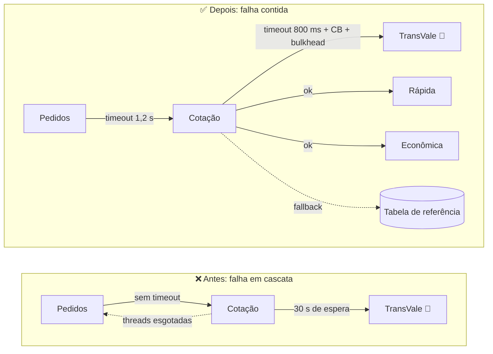

## Stack

- Java 17+, Spring Boot 3.x, Maven (multi-módulo)
- Resilience4j: timeout (TimeLimiter), retry, circuit breaker, bulkhead
- Micrometer + Micrometer Tracing (OpenTelemetry/OTLP) + Actuator + Prometheus
- Docker multi-estágio, Kubernetes (Deployment, Service, HPA), Jaeger via Compose

## Arquitetura

| Módulo | Porta | Responsabilidade |
|---|---|---|
| `cotacao-frete-service` | 8081 | Consulta as 3 transportadoras em paralelo, aplica resiliência e rate limit por loja |
| `pedidos-service` | 8082 | Registra pedidos validando o frete no serviço de cotação (armazenamento em memória) |
| `transportadoras-stub` | 8083 | Simula TransVale, Rápida e Econômica, com atraso/falha configuráveis |
| Jaeger | 16686 / 4318 | Visualização de traces (via Compose) |

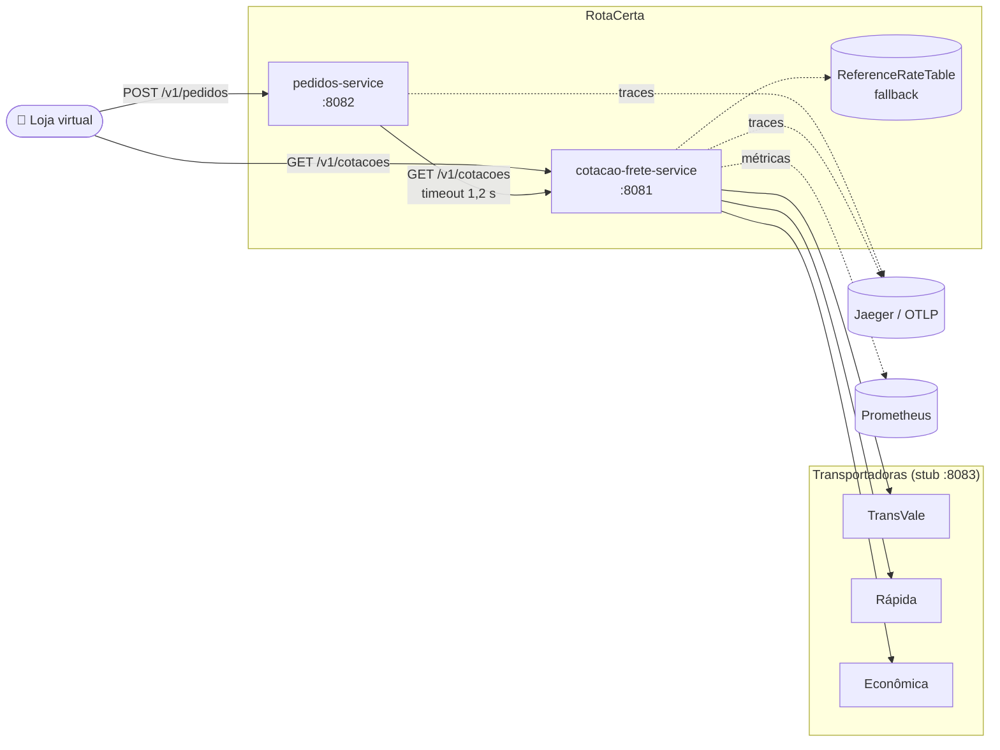

## Fluxo de uma cotação

O serviço dispara as 3 consultas em paralelo e escolhe o menor preço, **preferindo cotações reais** às estimadas.

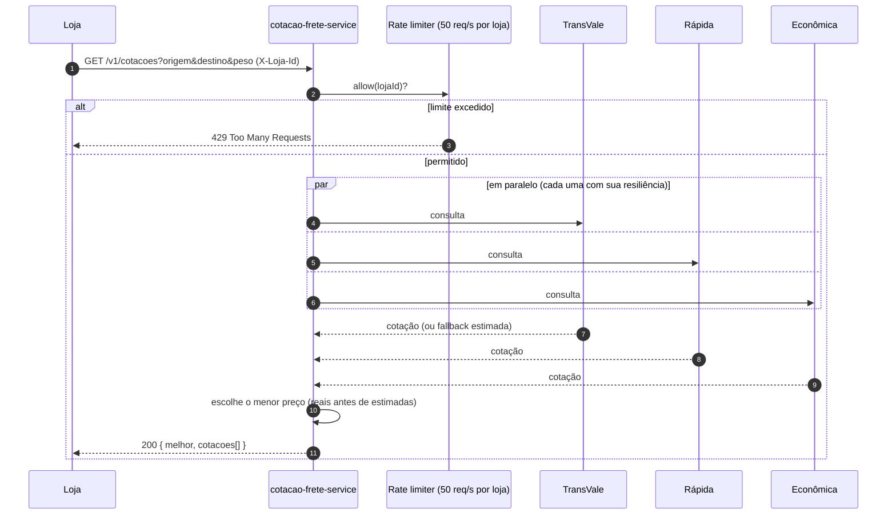

## Padrões de resiliência

Cada transportadora tem seus **próprios** circuit breaker, retry, bulkhead e timeout — a lentidão de uma não afeta as outras.

| Padrão | Configuração |
|---|---|
| **Timeout** | 800 ms por chamada a transportadora (`PARTNER_TIMEOUT_MS`); 1,2 s de Pedidos → Cotação |
| **Retry** | Máx. 2 tentativas (GET idempotente), backoff exponencial 100 ms → 200 ms → 400 ms (teto) + jitter de até 50% |
| **Circuit Breaker** | Janela de 20 chamadas; abre com ≥ 50% de falhas; aberto por 30 s; half-open com 10 chamadas de teste; transição automática |
| **Fallback** | Tabela de frete de referência, resposta marcada com `"estimada": true` |
| **Bulkhead** | Máx. 40 chamadas simultâneas por transportadora (sem espera) + pool de threads dedicado por parceiro |
| **Rate limiting** | 50 req/s por loja (`X-Loja-Id`), retornando HTTP 429 |

### Ordem de composição das camadas

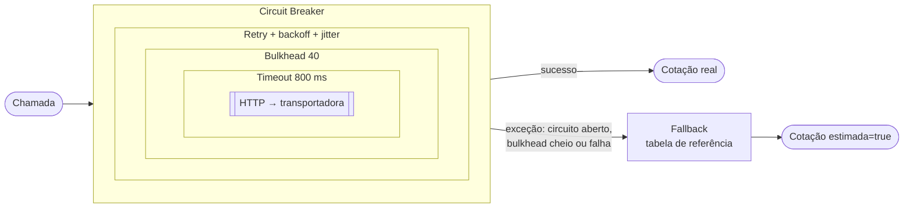

### Fluxo de decisão de uma chamada

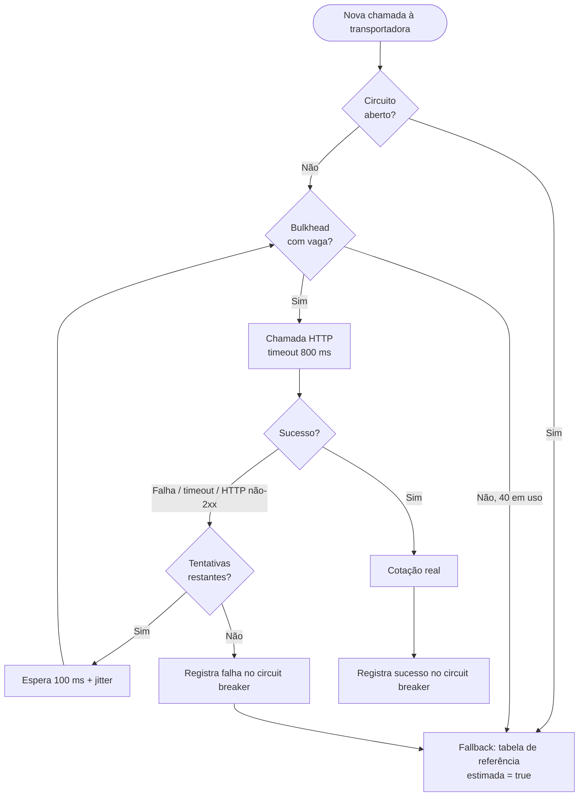

### Retry com backoff e jitter

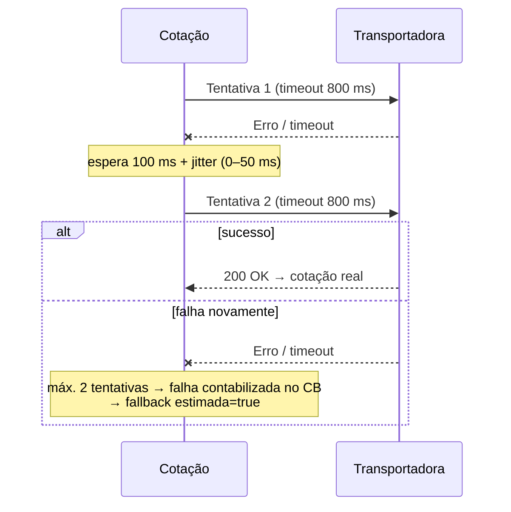

> O retry fica **dentro** do circuit breaker: o CB contabiliza o resultado final (após as tentativas), não cada tentativa individual.

### Máquina de estados do Circuit Breaker

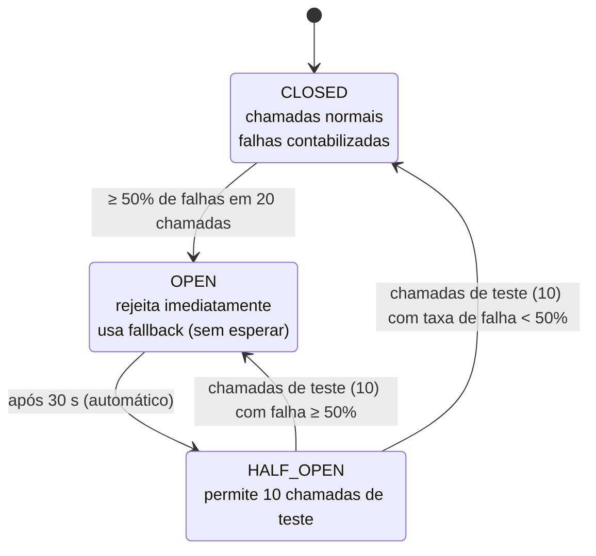

### Cenário: TransVale passa a responder em 30 s

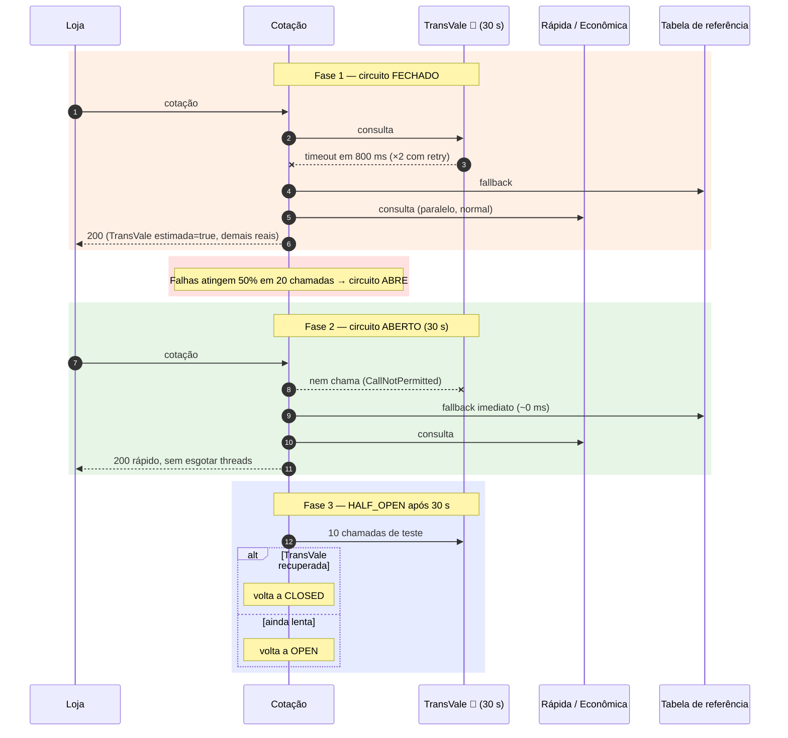

### Isolamento por bulkhead

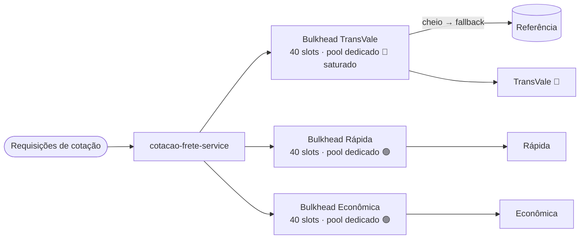

## Criação de pedido

`pedidos-service` valida o frete com timeout de 1,2 s. Como a cotação sempre responde (real ou estimada), o pedido só falha se a própria Cotação estiver indisponível — e nesse caso com **504** rápido, sem prender threads.

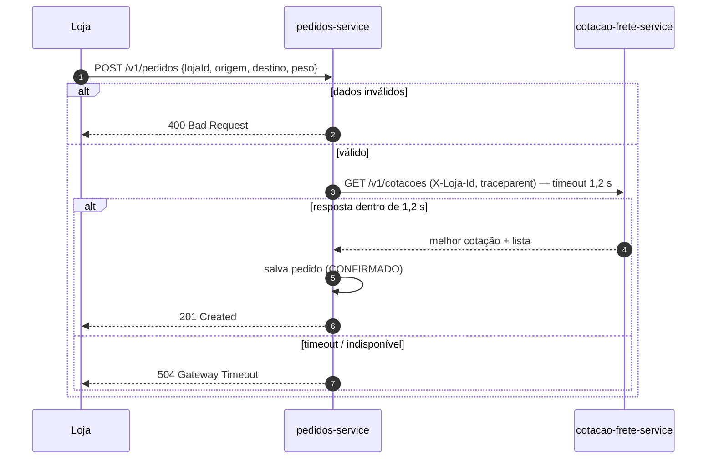

## Health checks

Lição do incidente: as probes **nunca** consultam parceiros externos. Antes, uma transportadora lenta fazia o health check falhar e as instâncias reiniciavam em sequência sem nenhum benefício.

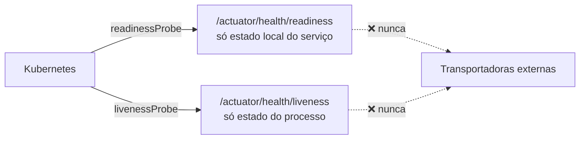

## Observabilidade

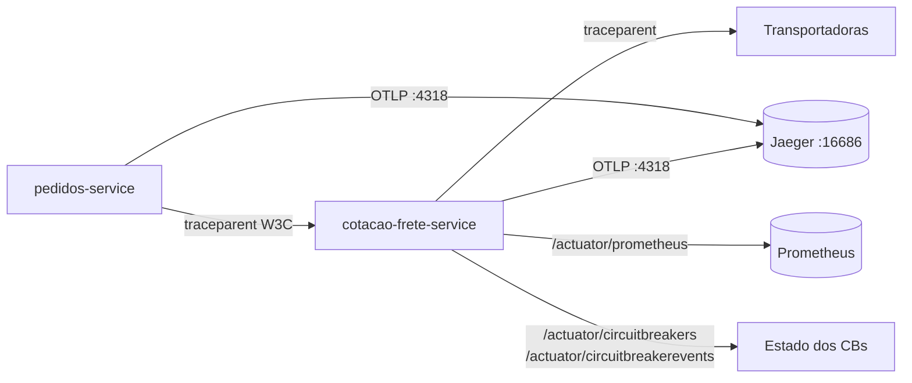

- Um trace por requisição, com span `carrier.quote` (tag `peer.service`) por transportadora, ponta a ponta Pedidos → Cotação → parceiro.
- Logs do Spring trazem `traceId`/`spanId` via MDC.
- Quatro sinais de ouro (latência, tráfego, erros, saturação) em `/actuator/metrics` e `/actuator/prometheus`.

## Contêineres e Kubernetes

- Dockerfile multi-estágio por serviço (JDK compila, JRE executa, usuário sem privilégios).
- Configuração por variáveis de ambiente (URLs, timeouts, atrasos do stub).
- Manifestos em `k8s/`: Deployments (requests/limits e probes), Services e HPA.

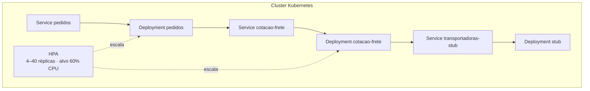

## Endpoints

| Serviço | Verbo | Rota | Comportamento |
|---|---|---|---|
| cotacao-frete-service | GET | `/v1/cotacoes?origem=&destino=&peso=` | Melhor cotação entre as 3 transportadoras (ou estimada via fallback); header `X-Loja-Id` aplica o rate limit |
| pedidos-service | POST | `/v1/pedidos` | Valida a cotação (timeout 1,2 s) e registra o pedido |
| pedidos-service | GET | `/v1/pedidos/{id}` | Consulta um pedido |
| cotacao-frete-service | GET | `/actuator/circuitbreakers`, `/actuator/circuitbreakerevents` | Estado e eventos dos circuit breakers |
| todos | GET | `/actuator/health`, `/actuator/prometheus` | Saúde e métricas |

## Executar o projeto

Requisitos: Java 17+, Maven 3.9+ e Docker com Docker Compose.

```bash
mvn test
docker compose up --build
```

- Cotação: `GET http://localhost:8081/v1/cotacoes?origem=SP&destino=RJ&peso=2` (envie `X-Loja-Id` para o limite por loja).
- Pedidos: `POST http://localhost:8082/v1/pedidos` com `{"lojaId":"loja-1","origem":"SP","destino":"RJ","peso":2}`.
- Traces: `http://localhost:16686` (Jaeger).

## Simulando falhas

```bash
TRANSVALE_DELAY_MS=30000 docker compose up --build   # TransVale lenta
TRANSVALE_FAIL=true docker compose up --build        # TransVale com erro
```

O stub aceita `*_DELAY_MS` e `*_FAIL` para `TRANSVALE`, `RAPIDA` e `ECONOMICA`. O teste `SlowCarrierResilienceTest` simula a resposta de 30 s e verifica que o circuito abre, o fallback é usado e as demais transportadoras continuam respondendo.

Para observar: dispare várias cotações e acompanhe `/actuator/circuitbreakers` — o circuito da `transvale` passa de `CLOSED` para `OPEN`, e as respostas passam a trazer `"estimada": true` para ela, sem aumento de latência.
